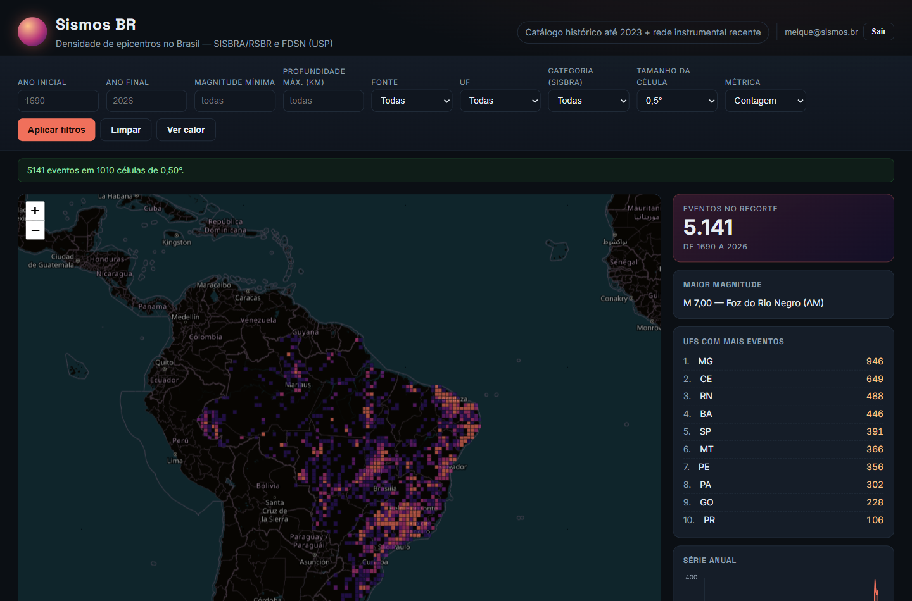

# Sismos BR — densidade de epicentros no Brasil

[](https://www.python.org)
[](https://www.postgresql.org)
[](https://postgis.net)
[](#testes)
[](LICENSE)

**🔗 Site no ar:** <https://sismos-br.duckdns.org> ·
**📄 Por trás dos panos (PDF técnico):**
[docs/Sismos_BR_por_tras_dos_panos.pdf](docs/Sismos_BR_por_tras_dos_panos.pdf)



Trabalho de faculdade: mapa interativo da densidade de epicentros no território
brasileiro a partir do catálogo histórico do **SISBRA/RSBR** (1690–2023) e do
catálogo **FDSN do Moho/IAG-USP** (2024 em diante).

## Destaques técnicos

- **Servidor HTTP próprio (só stdlib)**: roteamento por tabela, cookies,
  statics com suporte a Range e headers de segurança — sem framework, cada
  decisão é visível no código.
- **Densidade calculada no PostGIS**: grade alinhada por `floor`, área real
  em km² via `geography` (células de latitudes diferentes ficam comparáveis)
  e cortes de cor dinâmicos.
- **Segurança implementada e testada**: senhas em PBKDF2-HMAC-SHA256 (260 mil
  iterações + salt por usuário), sessão em cookie assinado com HMAC-SHA256,
  CSRF por duplo envio e limites anti força bruta.
- **Importação idempotente**: catálogos SISBRA + FDSN normalizados por parsers
  próprios, upsert por `(fonte, evento_id)` e recorte pela malha do IBGE.
- **Deploy real**: nginx + TLS, Cloudflare Tunnel e PostgreSQL/PostGIS no host,
  com backup `pg_dump`.
- **168 testes** unitários e de integração (incluem tentativas de path
  traversal e rate limit).

Aplicação em **Python puro, no padrão MVC, sem framework web** — mesma
arquitetura do projeto Geo Buss. Está publicada no servidor SSH `<host-do-servidor>`, com
PostgreSQL/PostGIS, processo Python e Cloudflare
Tunnel. A stack Docker também foi testada, mas não roda no servidor atual por
restrições do container.

## O que o site faz

- **Login e cadastro**: o usuário cria a própria conta (e-mail e senha) e entra na hora; senha guardada com PBKDF2 e sessão em cookie assinado.
- Página pública `/saiba-mais` com introdução e vídeo explicativo do sistema.
- Player escolhe sozinho o vídeo 1080×1920 no celular e 1920×1080 no computador.
- Grade de densidade com célula de 0,25°, 0,5°, 1° ou 2°.
- Duas métricas: contagem de eventos e eventos por 1.000 km² (normalizada).
- Filtros por período, magnitude, profundidade, fonte, UF e categoria SISBRA.
- Camada alternativa de mapa de calor (pontos individuais).
- Clique numa célula lista os eventos e abre a ficha completa de cada um.
- Painel com total, período, maior magnitude, top UFs, série anual, histograma
  de magnitudes e cobertura dos dados.
- Estado dos filtros fica na URL (link compartilhável).

## Arquitetura

```
navegador
   │  HTML/CSS/JS (Leaflet + leaflet.heat + Chart.js)
   ▼
app.py  ── http.server.ThreadingHTTPServer
   │  (método, caminho) → função
   ▼
rotas/rotas.py
   │
   ▼
controles/            validação dos filtros, respostas JSON/HTML
   │
   ▼
modelo/               SQL parametrizado, upsert, consultas espaciais
   │
   ▼
 PostgreSQL 16 + PostGIS 3.4   (servidor atual; grade via PostGIS)
```

A importação é offline do ponto de vista da requisição: um CLI baixa os
catálogos, normaliza e grava no banco; o site só lê o banco.

No host atual, `app.py`, PostgreSQL e `cloudflared` rodam como processos
nativos, não em containers. O host é um container sem systemd e sem suporte a
namespaces; por isso, um reinício do host exige executar
`scripts/start_servidor.sh` manualmente.

## Estrutura de pastas

```
app.py                 servidor HTTP e entrega de estáticos
config.py              configuração (lê .env), constantes e recorte do Brasil
rotas/                 tabela (método, caminho) → controller
controles/             home, validação de filtros, API, helpers de resposta
modelo/                sismos (upsert + consultas) e log de importações
servicos/              parsers SISBRA/FDSN, mapa codarea→UF, estatística
db/                    schema.sql e acesso ao Postgres (psycopg 3)
scripts/               importação, banco e operação do servidor SSH
templates/, static/    interface (HTML, CSS, JS)
docs/                  dados, servidor atual e Docker
tests/                 testes unitários + integração (SISMOS_TESTAR_DB=1)
tools/vm.py            ponte SSH/SCP (paramiko) para administração
```

## API

Todos os endpoints aceitam os filtros `ano_ini`, `ano_fim`, `mag_min`,
`mag_max`, `prof_max`, `fonte` (`todas|SISBRA|FDSN`), `uf`, `categoria` e
`celula` (0.25, 0.5, 1, 2). A validação é central e erro de filtro responde 400.

| Método | Rota | Descrição |
|---|---|---|
| GET | `/` | página com mapa e painel |
| GET | `/api/densidade` | células GeoJSON com contagem, densidade, cortes de cor |
| GET | `/api/sismos` | pontos GeoJSON para o mapa de calor (limite 6.000, teto 20.000) |
| GET | `/api/celula?lat=&lon=` | eventos da célula clicada |
| GET | `/api/evento?id=` | ficha completa do evento |
| GET | `/api/estatisticas` | total, período, maior evento, top UFs, série anual, histograma |
| GET | `/api/filtros` | opções reais do banco para os selects |
| GET | `/api/status` | saúde do banco, contagem por fonte, última importação |
| GET | `/api/importacoes` | últimas execuções do importador |

## Rodar localmente

```bash
python -m venv .venv
.venv\Scripts\activate        # Windows
pip install -r requirements-dev.txt
copy .env.example .env        # ajuste DB_HOST/DB_PASSWORD
python app.py
```

No Linux:

```bash
python3 -m venv .venv && . .venv/bin/activate
pip install -r requirements-dev.txt
cp .env.example .env
python app.py
```

O app sobe mesmo sem banco (a página abre e a API responde 503 com mensagem em
português). Para carregar os dados é preciso um PostGIS acessível.

## Página "Saiba mais" e vídeos

A rota pública `/saiba-mais` apresenta o projeto e o vídeo explicativo. O
player escolhe automaticamente:

- `static/videos/sismos-br-mobile.mp4` — 1080×1920, celular;
- `static/videos/sismos-br-desktop.mp4` — 1920×1080, computador.

Os MP4s não entram no Git porque são grandes. Poster, legendas e player ficam
versionados. Para publicar no servidor:

```bash
scp -P 2222 static/videos/*.mp4 static/videos/*.vtt static/videos/*.jpg \
  <usuario>@<host-do-servidor>:/home/<usuario>/sismos-br/static/videos/
```

## Importar os catálogos

```bash
python scripts/importar_catalogo.py               # SISBRA + FDSN
python scripts/importar_catalogo.py --somente fdsn
python scripts/importar_catalogo.py --sem-baixar  # usa dados/brutos
```

O upsert por `(fonte, evento_id)` torna a reimportação idempotente. Eventos fora
da malha do IBGE são removidos depois da carga.

## Testes

```bash
python -m unittest discover -s tests -v
```

Testes de banco são pulados por padrão; na VM:

```bash
SISMOS_TESTAR_DB=1 python -m unittest discover -s tests -v
```

## Estado atual da publicação (13/11/2026)

- Servidor SSH `<usuario>@<host-do-servidor>:2222` (Ubuntu 24.04 em container, sem
  systemd; Docker não consegue criar namespaces nesse host).
- PostgreSQL 16.15 + PostGIS 3.4.2; app Python 3.12.3 em
  `/home/melque/sismos-br`, porta 8080.
- URL pública estável: `https://sismos-br.duckdns.org` (nginx + TLS no host).
- Túnel rápido Cloudflare (alternativa temporária):
  `<tunel-efemero>` — muda se o
  `cloudflared` reiniciar.
- Base: **5.141 eventos** no recorte do Brasil (5.044 SISBRA + 97 FDSN).
- Docker Compose (`db`, `app`, `cloudflared`) foi construído e testado no
  Docker Desktop local; containers locais foram parados. A imagem não está
  rodando no servidor SSH.

Para conferir, iniciar serviços e atualizar dados, veja
[docs/SERVIDOR_SSH.md](docs/SERVIDOR_SSH.md). Para a stack Docker, veja
[docs/DOCKER.md](docs/DOCKER.md).

Detalhes em [docs/SERVIDOR_SSH.md](docs/SERVIDOR_SSH.md),
[docs/DADOS.md](docs/DADOS.md) e [docs/DOCKER.md](docs/DOCKER.md).

Guia completo de construção (11 páginas, com arquitetura, Cloudflare Tunnel,
deploy e checklist): [docs/Guia_Sismos_BR.pdf](docs/Guia_Sismos_BR.pdf).

## Decisões e limitações

- **Só território brasileiro**: filtro pela malha do IBGE (27 UFs). Eventos
  andinos ou oceânicos que aparecem no recorte são descartados.
- **Hora local do SISBRA**: registros com sufixo `L` são convertidos de UTC−3
  para UTC; sem hora, `data_hora` fica nula (o ano é preservado).
- **Coordenadas históricas arredondadas**: eventos antigos vêm em graus
  fechados (ex.: `-3,00 / -60,00`), então a célula mostra a precisão do
  catálogo, não a do epicentro real.
- **Viés de rede**: a partir de ~1980 o número de estações cresce muito; a
  série anual mede detecção, não necessariamente atividade sísmica.
- **Densidade normalizada**: a área de cada célula é calculada em km² pelo
  PostGIS (`geography`), por isso células em latitudes diferentes são
  comparáveis.
- **Célula clicada**: o evento pertence à célula cujo canto é
  `floor(coord / célula) * célula`; é a mesma conta usada na agregação.
- **Catálogo SISBRA até 2023 + FDSN de 2024 em diante**, sem sobreposição.
- **Túnel rápido da Cloudflare** é adequado para demonstração; para um link
  fixo é preciso um túnel nomeado (ver `docs/SERVIDOR_SSH.md`).
